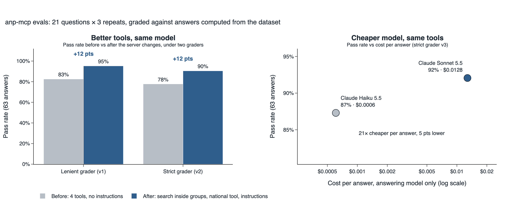

# anp-mcp

An MCP server that lets AI assistants (Claude, Cursor, and any MCP client) answer
questions about **Brazilian oil production**, using ANP's well-level data harmonised
from 2005 to today.

ANP publishes production per well, but not through an API: files change format
over time, wells and contracts get renamed, and the online query is behind a captcha.
This server works on a cleaned, harmonised snapshot of that data, published as an
[open dataset on Hugging Face](https://huggingface.co/datasets/lorenamelos/anp-oil-production),
so you can simply ask:

> *"Which oil fields grew and declined the most in the last 6 months?"*

| Largest rises (Apr–Sep 2026 vs Oct 2025–Mar 2026) | Before (bbl/d) | Recent (bbl/d) | Change |
|---|---|---|---|
| Búzios | 836,755 | 1,056,771 | +26.3% |
| Mero | 653,417 | 750,764 | +14.9% |
| Bacalhau | 32,119 | 99,492 | +209.8% |

## Can you trust the numbers?

The sum of all wells reproduces ANP's official national production **within ±1% in
every one of the 261 months** from January 2005 to September 2026 (worst month:
+0.52%, March 2008). The server exposes this check as a tool, so the assistant can
show it whenever it answers.

## Evals: does it answer correctly?



21 questions with answers computed from the dataset, each asked 3 times, scored by a grader
that also checks where every figure came from. The server changes added 12 points under
both graders, and no answer from the improved server was failed for invented data. Claude
Haiku 5.5 passes 87% at 1/21 of the cost per answer of Claude Sonnet 5.5. Details:
[evals/RESULTS.md](evals/RESULTS.md).

Read-only by design: tools run fixed, parameterised queries; no tool can write files or run
arbitrary SQL.

## Tools

| Tool | What it answers |
|---|---|
| `search_field_groups` | Find a field by name (accent-insensitive): *"buzios"* → BÚZIOS |
| `field_group_production` | Monthly production (bbl/d) and active wells of one field |
| `top_changes` | Fields that grew or declined the most over the last N months, with the method |
| `national_reconciliation` | The trust check above: summary by default, every month on request |
| `national_production` | Brazil's total petroleum production (bbl/d, onshore/offshore) from ANP's national series, by month or by year; incomplete years are flagged |

A **field group** is the unit used here: fields that were renamed, merged or split by
contract are grouped (e.g. TUPI includes LULA), so a series does not break when ANP
changes a name.

## How it works

```text
ANP raw files  ->  harmonisation pipeline  ->  open dataset (Hugging Face, versioned)
                                                     |  downloaded once, then cached
                     your AI assistant  <-  anp-mcp (DuckDB, runs on your machine)
```

On first use the server downloads the three small files it needs (`field_group_month.parquet`,
`national_check.csv`, `field_groups.csv`) from the
[dataset](https://huggingface.co/datasets/lorenamelos/anp-oil-production) and caches them;
after that it works offline. It is pinned to one dataset version, so answers do not
change silently when a new month is published. No database to install, no account
needed, and your questions are not sent anywhere except to your own AI assistant.
Units: petroleum = oil + condensate, daily rate (bbl/d).

## Install

Requires [uv](https://docs.astral.sh/uv/).

### Install without cloning

The server runs straight from GitHub; on the first tool call it downloads the dataset from
Hugging Face and caches it locally.

**Claude Code**

```sh
claude mcp add anp-mcp -- uvx --from git+https://github.com/lorenamelos/anp-mcp@v0.1.0 anp-mcp
```

**Claude Desktop** (or any MCP client using a JSON config, e.g. `claude_desktop_config.json`),
then restart the client:

```json
{
  "mcpServers": {
    "anp-mcp": {
      "command": "uvx",
      "args": ["--from", "git+https://github.com/lorenamelos/anp-mcp@v0.1.0", "anp-mcp"]
    }
  }
}
```

### From a local clone (for development)

```bash
git clone https://github.com/lorenamelos/anp-mcp.git
```

Point your MCP client at the clone, then restart the client:

```json
{
  "mcpServers": {
    "anp-mcp": {
      "command": "uv",
      "args": ["--directory", "/path/to/anp-mcp", "run", "anp-mcp"]
    }
  }
}
```

Optional environment variables (both install modes):

| Variable | Default | Use |
|---|---|---|
| `ANP_MCP_REVISION` | `v2026.09` | Dataset version to read |
| `ANP_MCP_DATASET` | `lorenamelos/anp-oil-production` | Dataset repository |
| `ANP_MCP_DATA_DIR` | not set | Read the dataset files from a local folder instead |

## Limitations

- A **snapshot**, not a live feed: ANP publishes each month about two months later,
  and the dataset is updated by release.
- Production only (petroleum, wells, fields). Gas detail and royalties are planned.
- Field groups follow documented, rule-based grouping; another analyst could group
  some edge cases differently.

## Data and licence

Data: Agência Nacional do Petróleo, Gás Natural e Biocombustíveis (ANP), open data,
harmonised in the [anp-oil-production](https://huggingface.co/datasets/lorenamelos/anp-oil-production)
dataset (CC BY 4.0). This is an independent project, not affiliated with ANP. Code: MIT.

Built by [Lorena Melo](https://www.linkedin.com/in/lorenameloengr/).
